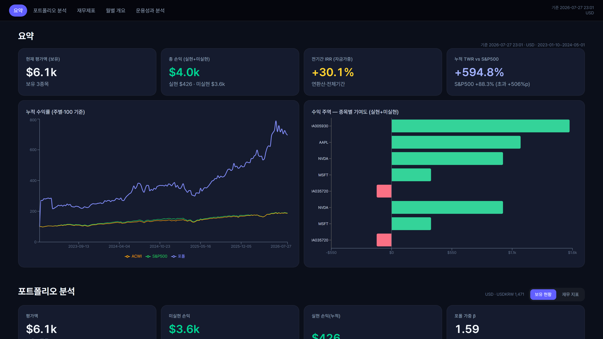
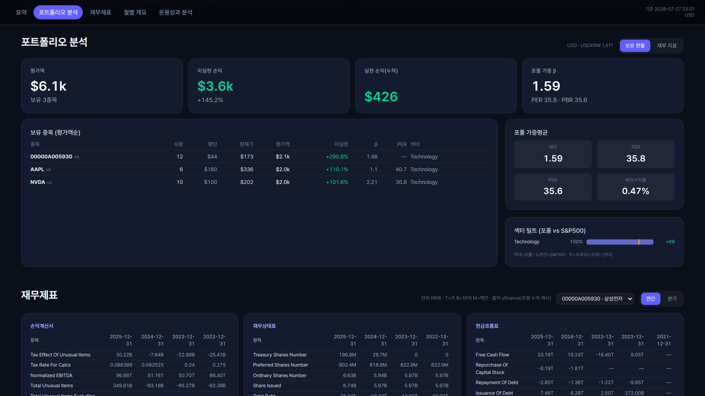
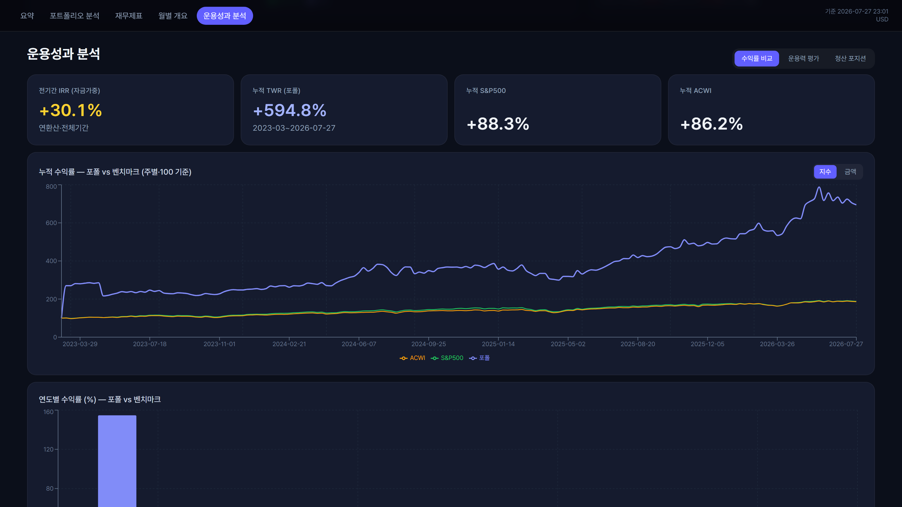
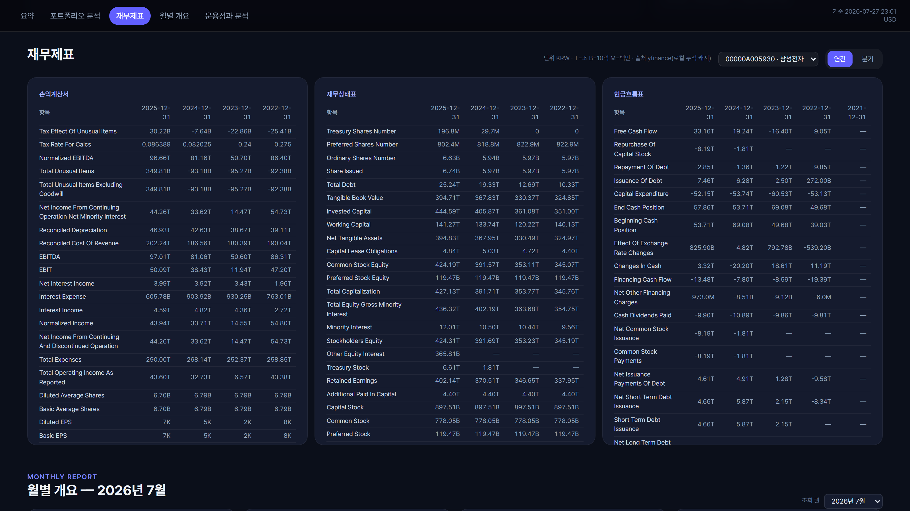

<div align="center">

# KIS Portfolio Report

**한국투자증권(KIS) OpenAPI로 내 계좌를 분석하는 개발자·AI용 CLI + MCP 도구**

TWR·IRR·스타일조정 알파·MDD까지 계산해 **웹 대시보드**와 **구조화 JSON**으로 제공합니다.

[](LICENSE)


</div>



> ⚠️ 개인이 만든 **비공식** 도구입니다. 한국투자증권과 무관하며 무보증·투자조언이 아닙니다. 사용 전 **[DISCLAIMER.md](DISCLAIMER.md)** 를 읽어주세요.
> *(스크린샷은 전부 `--mock` 가짜 데이터입니다.)*

## 무엇이 다른가

증권사 앱은 **"얼마 벌었나"** 는 보여주지만 **"잘 운용했나"** 는 알려주지 않습니다. 이 도구는 후자를 계산합니다.

- **TWR + IRR 둘 다** — 시간가중(운용 실력)과 자금가중(실제 내 돈의 수익률)은 다른 질문에 답합니다
- **스타일조정 알파** — 초과수익을 `[시장 + 성장팩터]` 로 회귀해 스타일 노출을 걷어낸 **잔차 알파**. "성장주가 올라서" 번 건지 "잘 골라서" 번 건지 구분합니다
- **코퍼레이트 액션 정확성** — 분할·합병·무상입고는 별도 원장 API가 없어 자체 계산 시 실현손익이 과대집계됩니다. 그래서 **브로커가 이미 반영해 계산한 잔고·실현손익 권위값**을 채택합니다
- **재무제표 아카이빙** — yfinance는 롤링 윈도우(연 ~4년)만 주고 과거를 떨굽니다. 받은 기간을 로컬 SQLite에 **누적**해 시간이 지날수록 데이터가 쌓입니다
- **AI 네이티브** — MCP 서버로 Claude 등에 그대로 물려 `query_db(sql)` 까지 열어둡니다
- **전부 로컬** — 자격정보·거래내역·DB 모두 내 PC. 외부 통신은 KIS API와 yfinance(티커 조회)뿐

## Quickstart

전제: [uv](https://docs.astral.sh/uv/), Node 20+, [KIS Developers](https://apiportal.koreainvestment.com/) 실전투자 APP_KEY.

```bash
git clone https://github.com/Cafelatte1/kis-financial-report && cd kis-financial-report
cp .env.example .env            # KIS_APP_KEY / KIS_SECRET_KEY / KIS_ACC 입력
cd create-report && npm install && npm run build && cd ..   # 대시보드 빌드(1회)

cd kis
uv run kis update               # KIS OpenAPI 수집 → ETL → 지표 계산 (수 분)
uv run kis serve                # http://127.0.0.1:8777
```

계정 없이 먼저 보고 싶다면 `uv run kis update --mock` — 가짜 데이터로 격리 실행되어 실제 DB를 건드리지 않습니다.

## CLI

| 명령 | 동작 |
|---|---|
| `kis update [--from-date --to-date] [--mock]` | 전체 갱신: API 수집 → ETL → 지표계산 |
| `kis serve [--port 8777] [--no-browser]` | 웹 대시보드 서빙 (보기 전용) |
| `kis status [--json]` | 데이터 존재·asof·보유종목 수 (exit 0 = 정상) |
| `kis export {report\|holdings\|trades\|financials}` | 리포트 JSON을 stdout으로 (파이프/AI용) |

데이터는 **repo 로컬**에 저장됩니다(전부 gitignore): DB `kis/portfolio.db`, JSON `create-report/public/data/`.
`KIS_DATA_DIR` 환경변수 또는 `--data-dir` 로 위치를 바꿀 수 있습니다.

## MCP (AI 클라이언트 연동)

루트 `.mcp.json` 이 커밋되어 있어 **Claude Code에서 열면 자동 연결**됩니다. 다른 클라이언트는:

```json
{ "mcpServers": { "kis-portfolio": {
    "command": "uv", "args": ["run", "--project", "<repo>/kis", "kis-mcp"] } } }
```

| 도구 | 내용 |
|---|---|
| `get_summary` / `get_holdings` | KPI·환율 / 보유종목(평단·평가액·재무지표) |
| `get_performance` / `get_closed_positions` | TWR·알파·샤프·MDD / 청산 포지션·승률 |
| `get_trades(symbol?, limit)` | 체결내역 조회 |
| `get_financial_statements(symbol, freq)` | 손익/재무상태/현금흐름 (annual/quarterly) |
| `query_db(sql)` | `portfolio.db` **read-only** 자유 질의 |
| `update_portfolio(from?, to?)` | 전체 갱신 실행 (수 분 소요) |

## 대시보드

<details>
<summary><b>포트폴리오 분석</b> — 보유표·가중평균(β/PER/PBR/배당)·섹터 틸트</summary>


</details>

<details>
<summary><b>운용성과 분석</b> — TWR vs S&P500/ACWI·연도별 승패·운용력·리스크</summary>


</details>

<details>
<summary><b>재무제표</b> — 보유종목별 손익/재무상태/현금흐름 (연간·분기)</summary>


</details>

## 아키텍처

```
KIS OpenAPI ─→ api_ingest ─→ portfolio.db ─→ etl ─→ compute ─→ JSON 3종 ─→ React 대시보드
                                  ↑                                          (표시 전용)
                yfinance 캐시(가격·지표·분할·재무제표 누적) — 전부 로컬 SQLite
```

| 폴더 | 역할 |
|---|---|
| `kis/` | **코어** — 수집(`api_ingest`)·DB(`db`)·정규화(`etl`)·시장데이터(`market`)·전 지표(`compute`) + `cli.py`·`mcp_server.py` |
| `create-report/` | React 대시보드 (계산 없음, JSON 표시 전용) |

`portfolio.db` 는 3계층입니다 — **입력(raw)** 는 KIS API 원본, **파생**은 `etl` 이 재생성, **캐시**(yfinance)는 영속.
자세한 설계는 [`kis/README.md`](kis/README.md), 대시보드 구성은 [`create-report/README.md`](create-report/README.md).

## 한계

- **KR/US 종목만** 지표에 반영됩니다 (CN/JP/HK 등은 raw 에 보존만)
- KIS **실전투자** 계좌·APP_KEY 가 필요합니다 (모의투자 미지원)
- KIS 토큰 발급은 **1회/분** 제한이라 `update` 연속 실행이 막힙니다
- TWR 은 가격 커버리지가 높은 최근 구간만 계산합니다 (상폐·초기 종목은 과거 재구성 불가 → 헤더에 구간 표기)
- 예수금(현금) 은 수집하지 않아 평가액에 포함되지 않습니다

## 라이선스

[MIT](LICENSE) — 단, [DISCLAIMER.md](DISCLAIMER.md) 의 위험 고지에 동의하는 경우에 한합니다.
AI 에이전트용 작업 가이드는 [`CLAUDE.md`](CLAUDE.md) 를 참고하세요.
